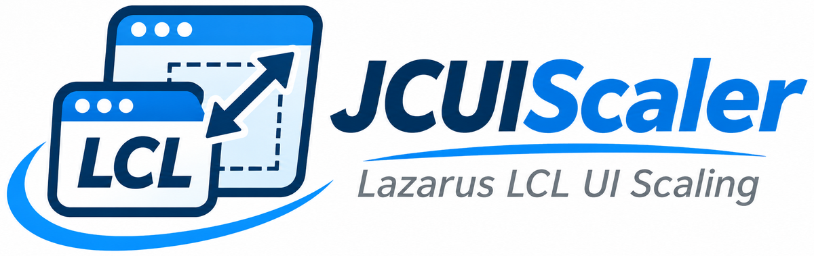
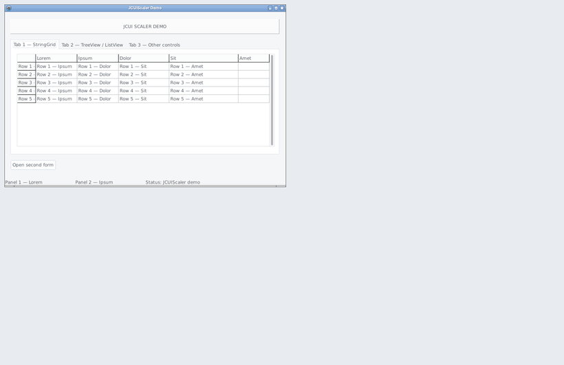
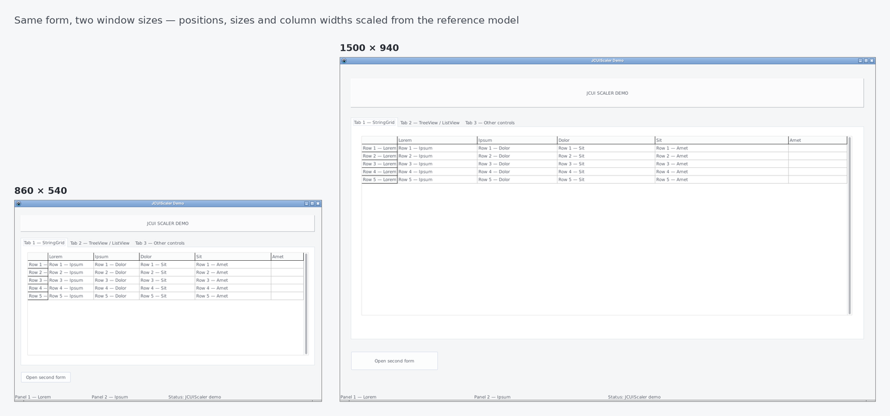
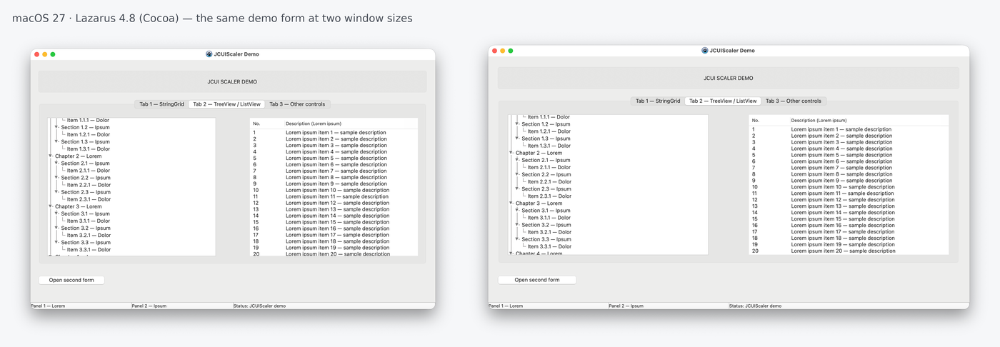

<p align="center">
  <picture>
    <source media="(prefers-color-scheme: dark)" srcset="assets/logo/JCUIScaler_logo_dark_1200.png">
    
  </picture>
</p>

**Deterministic, proportional UI scaling for Lazarus LCL forms.**
Resize the window — every control scales with it. No anchoring of hundreds of controls, no drift after repeated resizing.

*Polska wersja: [README.pl.md](README.pl.md)*

<p align="center">
  
</p>

<p align="center">
  
</p>

<p align="center"><sub>The demo project on Linux/GTK2. The window grows to 1500 × 940 and returns to its starting size; the last frame is pixel-identical to the first — no drift.</sub></p>

<p align="center">
  
</p>

<p align="center"><sub>The same demo on macOS 27 with Lazarus 4.8 (Cocoa).</sub></p>

---

## Why

The LCL has an excellent layout system (Align, Anchors, BorderSpacing, ChildSizing). For business forms with dozens or hundreds of fields, and for applications migrated from Delphi tools like ResizeKit, configuring it control by control is impractical. JCUIScaler takes a different approach: it records the original geometry of the form once and, on every resize, scales every control proportionally **from that reference model** — never from the current, already scaled state. Rounding errors cannot accumulate.

## Features

- Proportional scaling of position and size of all controls, recursively.
- **Deterministic reference model** — repeated resizing returns to exactly the same pixels.
- Dedicated handling for TStringGrid / TDBGrid (column widths), TListView (columns), TStatusBar (panels), TTreeView (indent), TSplitter, TPageControl, TPanel bevels.
- Optional BorderSpacing scaling per control (`JCSCALER_BORDER_TAG`).
- Two ways to integrate: **drop the `TJCScaler` component on a form** (zero code), or **three calls** in your own code.
- Component extension points: `BeforeShow` / `AfterShow` / `BeforeResize` / `AfterResize` events and virtual methods.
- No dependency on system DPI; works with `Form.Scaled`.
- Free and open source — same license as the LCL.

## Quick start

### Option A — component (recommended)

1. In Lazarus open `packages/lazarus/jcuiscaler_dsgn.lpk` → *Use → Install* (rebuilds the IDE; `jcuiscaler_rt.lpk` is used automatically).
2. Drop **TJCScaler** from the **JCUI** palette page on a form.
3. Run. That's it.

Set `ResetOnShow` / `SkipBevelScaling` in the Object Inspector if needed.

### Option B — manual integration (three calls)

Copy `JCUIScaler.pas` and the three `.inc` files from `source/` into your project (or add `source/` to the search path):

```pascal
uses JCUIScaler;

type
  TMainForm = class(TForm)
  private
    FScaler: TJCUIScaler;
  end;

procedure TMainForm.FormCreate(Sender: TObject);
begin
  FScaler.ScalerInit(Self);
  // optional, after ScalerInit:
  // FScaler.ResetOnShow := True;
end;

procedure TMainForm.FormShow(Sender: TObject);
begin
  FScaler.ScalerOnShow;     // mandatory: builds the reference model
end;

procedure TMainForm.FormResize(Sender: TObject);
begin
  FScaler.ScalerOnResize;
end;
```

`TJCUIScaler` is an `object` (no Create/Free). Declare it as a form field.

## TJCScaler component

| Member | Description |
|---|---|
| `SkipBevelScaling` (default `True`) | Keeps TPanel bevel and border widths unscaled. |
| `ResetOnShow` (default `False`) | Restores the original size and layout every time the form is shown. |
| `BeforeShow`, `AfterShow` | Around the scaler on every form show. On the first show `BeforeShow` runs before the reference model is captured. |
| `BeforeResize`, `AfterResize` | Around the scaler on every resize. Use `AfterResize` for adjustments the scaler does not make (fonts, controls outside the model, custom drawing). |
| `DoShow`, `DoResize` (protected, virtual) | Override in a descendant; call `inherited` to run the events and the scaler. |
| `Attach` | Call after creating the component in code, or after your code replaced the form's `OnShow` at run time. |
| `Rescale` | Re-runs the scaler at the current size. |
| `RestoreInitialScale` | Emergency reset to the captured original state. |

Order on show: form `OnShow` → `BeforeShow` → scaler → `AfterShow`.
Order on resize: form `OnResize` → `BeforeResize` → scaler → `AfterResize`.
Your own `OnShow` / `OnResize` handlers keep working.

## Recommendations and FAQ

**Controls jump around when the form opens on another DPI.**
Keep the default `Anchors = [akLeft, akTop]`. Clearing anchors (`Anchors = []`) lets the LCL move controls during its DPI auto-scaling before JCUIScaler captures the layout.

**TListView shows a horizontal scrollbar after switching tabs.**
A native TListView on a hidden tab sheet reports its client width without the vertical scrollbar. Set `ScrollBars = ssVertical` — JCUIScaler fits the columns to the width anyway, so a horizontal scrollbar is never needed. On Windows you can also call `FScaler.ScalerOnResize` (component: `JCScaler1.Rescale`) in `TPageControl.OnChange` for exact widths immediately. LCL grids are not affected.

**On Linux/GTK2 both scrollbars are always visible.**
That is the GTK2 meaning of `ScrollBars = ssBoth` (the LCL default). Use `ssVertical` or `ssAutoBoth`.

**I create controls at run time.**
The reference model is captured on the first show. After adding controls call `ScalerInit` and `ScalerOnShow` again.

**Fonts do not grow.**
By design in 1.0: font scaling depends on DPI, platform and OS version too much to be deterministic. Use `AfterResize` if you need it.

**TToolButton is not scaled.** Intentional. TSpeedButton is scaled normally.

**BorderSpacing.** To scale a control's BorderSpacing set `MyPanel.Tag := MyPanel.Tag or JCSCALER_BORDER_TAG;` (TWinControl descendants, LCL only).

## Limitations (1.0)

- No font scaling.
- Moving a `Form.Scaled` window between monitors with different DPI is not handled.
- One `TJCScaler` per form; the owner must be a `TForm`.
- Tested on Windows 11 (Lazarus 4.8), macOS 27 (Lazarus 4.8, Cocoa) and Linux/GTK2 (Lazarus 3.0, FPC 3.2.2). The Qt widgetset has not been tested.
- **Delphi (unofficial):** the core compiles as source with Delphi VCL — verified with Delphi 13.2 (Win64), including third-party controls (TMS UI Pack PageControl, RxDBGrid). Manual integration only, no package; `JCSCALER_BORDER_TAG` is ignored and `TSplitter` (a graphic control in VCL) gets generic scaling only. The demo and the component are Lazarus-only.

## Requirements

Lazarus 3.0+ with FPC 3.2.2+ (tested with Lazarus 4.8 on Windows 11 and macOS 27, and Lazarus 3.0 on Linux). Widgetsets: Win32/Win64, Cocoa, GTK2; Qt not tested. Delphi (unofficial, manual integration): verified with Delphi 13.2 (Win64).

## Repository layout

```
source/             scaler core (JCUIScaler.pas + 3 .inc) and the component
source/design/      IDE registration and palette icons
packages/lazarus/   jcuiscaler_rt.lpk (runtime), jcuiscaler_dsgn.lpk (design time)
demo/               demo project (Lazarus, manual integration)
docs/en, docs/pl    technical specification (current)
docs/*/Additional   static analysis, risk analysis, roadmap (development record up to 1.0)
.github/            CI (build check) and issue / pull request templates
assets/             logo, icons and screenshots
```

## Documentation

The **Technical Specification** — architecture, algorithms, configuration recommendations, API — is in [`docs/en`](docs/en) (Polish original in [`docs/pl`](docs/pl)). It is the current, maintained document. The supplementary documents in `docs/*/Additional` (static analysis, risk analysis, roadmap) record the development up to version 1.0 and are not updated on an ongoing basis. Every document is provided as PDF (readable in the browser) and DOCX. Change log: [`HISTORY.txt`](HISTORY.txt).

## Contributing

Contributions are welcome — bug reports, platform test reports, fixes and features. Please read [`CONTRIBUTING.md`](CONTRIBUTING.md) first: it lists the architecture rules every change must respect.

Help is especially wanted with **moving windows between monitors with different DPI** (LCL and Delphi/VCL) and with **font scaling** (experimental). See the issues labelled *help wanted*.

## License

Same license as the Lazarus Component Library: **GNU Library General Public License version 2 with the static linking exception** ("modified LGPL") — see [`LICENSE`](LICENSE), [`COPYING.modifiedLGPL.txt`](COPYING.modifiedLGPL.txt) and [`COPYING.LGPL.txt`](COPYING.LGPL.txt). You may use JCUIScaler in closed-source applications. The copyright notice and the author's name must stay in the source files.

Copyright © 2025-2026 Jakub Cebula, Kraków.
