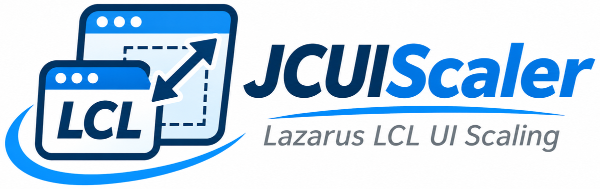
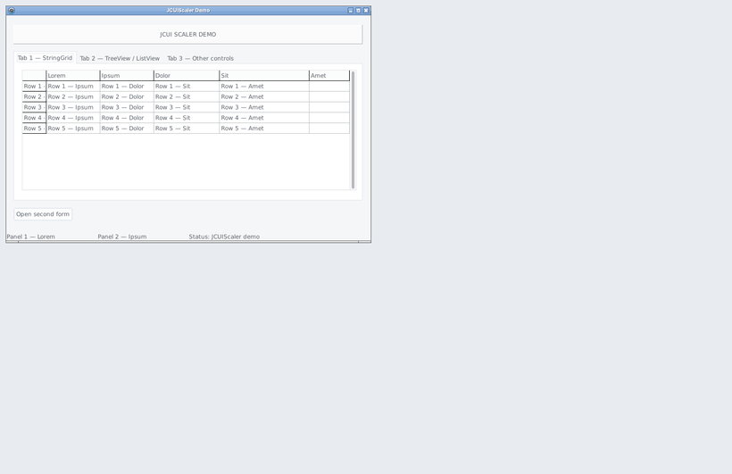
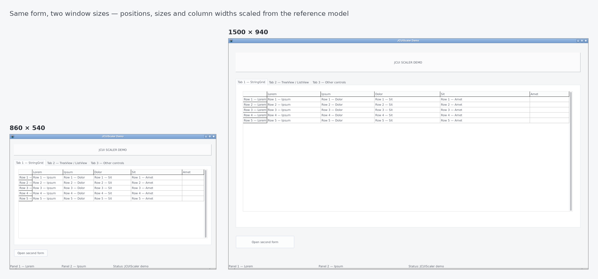
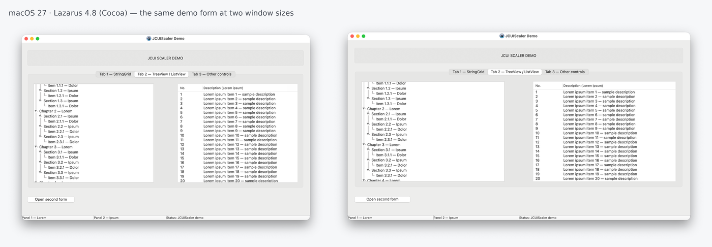

<p align="center">
  <picture>
    <source media="(prefers-color-scheme: dark)" srcset="assets/logo/JCUIScaler_logo_dark_1200.png">
    
  </picture>
</p>

**Deterministyczne, proporcjonalne skalowanie interfejsu formularzy Lazarus LCL.**
Zmieniasz rozmiar okna — wszystkie kontrolki skalują się razem z nim. Bez ustawiania kotwic setkom kontrolek, bez dryfu po wielokrotnej zmianie rozmiaru.

*English version: [README.md](README.md)*

<p align="center">
  
</p>

<p align="center">
  
</p>

<p align="center"><sub>Projekt demonstracyjny na Linux/GTK2. Okno rośnie do 1500 × 940 i wraca do rozmiaru początkowego; ostatnia klatka jest identyczna co do piksela z pierwszą — bez dryfu.</sub></p>

<p align="center">
  
</p>

<p align="center"><sub>To samo demo na macOS 27 z Lazarusem 4.8 (Cocoa).</sub></p>

---

## Po co

LCL ma bardzo dobry system układu (Align, Anchors, BorderSpacing, ChildSizing). Przy formularzach biznesowych z dziesiątkami lub setkami pól, a także przy aplikacjach przenoszonych z Delphi, gdzie używano narzędzi typu ResizeKit, konfigurowanie go kontrolka po kontrolce jest niepraktyczne. JCUIScaler działa inaczej: raz zapisuje oryginalną geometrię formularza, a przy każdej zmianie rozmiaru skaluje proporcjonalnie wszystkie kontrolki **względem tego modelu referencyjnego** — nigdy względem bieżącego, już przeskalowanego stanu. Błędy zaokrągleń nie mogą się kumulować.

## Możliwości

- Proporcjonalne skalowanie położenia i rozmiaru wszystkich kontrolek, rekurencyjnie.
- **Deterministyczny model referencyjny** — po wielokrotnej zmianie rozmiaru powrót do dokładnie tych samych pikseli.
- Dedykowana obsługa TStringGrid / TDBGrid (szerokości kolumn), TListView (kolumny), TStatusBar (panele), TTreeView (wcięcie), TSplitter, TPageControl, bevelów TPanel.
- Opcjonalne skalowanie BorderSpacing wybranych kontrolek (`JCSCALER_BORDER_TAG`).
- Dwa sposoby integracji: **komponent `TJCScaler` rzucony na formularz** (zero kodu) albo **trzy wywołania** we własnym kodzie.
- Punkty rozszerzeń komponentu: zdarzenia `BeforeShow` / `AfterShow` / `BeforeResize` / `AfterResize` oraz metody wirtualne.
- Brak zależności od DPI systemu; działa z `Form.Scaled`.
- Darmowy i otwarty — ta sama licencja co LCL.

## Szybki start

### Wariant A — komponent (zalecany)

1. W Lazarusie otwórz `packages/lazarus/jcuiscaler_dsgn.lpk` → *Use → Install* (przebudowa IDE; `jcuiscaler_rt.lpk` zostanie użyty automatycznie).
2. Rzuć **TJCScaler** ze strony palety **JCUI** na formularz.
3. Uruchom. To wszystko.

W razie potrzeby ustaw `ResetOnShow` / `SkipBevelScaling` w Object Inspectorze.

### Wariant B — integracja ręczna (trzy wywołania)

Skopiuj `JCUIScaler.pas` i trzy pliki `.inc` z katalogu `source/` do projektu (albo dodaj `source/` do ścieżek wyszukiwania):

```pascal
uses JCUIScaler;

type
  TMainForm = class(TForm)
  private
    FScaler: TJCUIScaler;
  end;

procedure TMainForm.FormCreate(Sender: TObject);
begin
  FScaler.ScalerInit(Self);
  // opcjonalnie, po ScalerInit:
  // FScaler.ResetOnShow := True;
end;

procedure TMainForm.FormShow(Sender: TObject);
begin
  FScaler.ScalerOnShow;     // obowiązkowe: buduje model referencyjny
end;

procedure TMainForm.FormResize(Sender: TObject);
begin
  FScaler.ScalerOnResize;
end;
```

`TJCUIScaler` jest typu `object` (bez Create/Free). Deklaruj go jako pole formularza.

## Komponent TJCScaler

| Element | Opis |
|---|---|
| `SkipBevelScaling` (domyślnie `True`) | Nie skaluje szerokości bevelów i ramek TPanel. |
| `ResetOnShow` (domyślnie `False`) | Przy każdym pokazaniu formularza przywraca oryginalny rozmiar i układ. |
| `BeforeShow`, `AfterShow` | Przed i po skalerze przy każdym pokazaniu formularza. Przy pierwszym pokazaniu `BeforeShow` działa przed zapisaniem modelu referencyjnego. |
| `BeforeResize`, `AfterResize` | Przed i po skalerze przy każdej zmianie rozmiaru. `AfterResize` służy do dostosowań, których skaler nie robi (czcionki, kontrolki spoza modelu, rysowanie własne). |
| `DoShow`, `DoResize` (protected, virtual) | Do nadpisania w klasie potomnej; `inherited` uruchamia zdarzenia i skaler. |
| `Attach` | Wywołaj po utworzeniu komponentu w kodzie albo gdy Twój kod podmienił `OnShow` formularza w czasie działania. |
| `Rescale` | Ponownie uruchamia skaler przy bieżącym rozmiarze. |
| `RestoreInitialScale` | Awaryjny reset do zapisanego stanu pierwotnego. |

Kolejność przy pokazaniu: `OnShow` formularza → `BeforeShow` → skaler → `AfterShow`.
Kolejność przy zmianie rozmiaru: `OnResize` formularza → `BeforeResize` → skaler → `AfterResize`.
Twoje własne `OnShow` / `OnResize` nadal działają.

## Zalecenia i FAQ

**Kontrolki rozjeżdżają się przy otwarciu formularza na innym DPI.**
Zostaw domyślne `Anchors = [akLeft, akTop]`. Wyczyszczenie kotwic (`Anchors = []`) pozwala LCL przesunąć kontrolki podczas automatycznego skalowania DPI, zanim JCUIScaler zapisze układ.

**TListView pokazuje poziomy pasek przewijania po przełączeniu zakładki.**
Natywny TListView na ukrytej zakładce podaje szerokość obszaru klienta bez pionowego paska. Ustaw `ScrollBars = ssVertical` — JCUIScaler i tak dopasowuje kolumny do szerokości, więc poziomy pasek nie jest potrzebny. Na Windows możesz też wywołać `FScaler.ScalerOnResize` (komponent: `JCScaler1.Rescale`) w `TPageControl.OnChange`, aby od razu mieć dokładne szerokości. Gridów LCL to nie dotyczy.

**Na Linuksie (GTK2) oba paski przewijania są zawsze widoczne.**
Tak GTK2 interpretuje `ScrollBars = ssBoth` (domyślne w LCL). Użyj `ssVertical` albo `ssAutoBoth`.

**Tworzę kontrolki w czasie działania.**
Model referencyjny jest zapisywany przy pierwszym pokazaniu. Po dodaniu kontrolek wywołaj ponownie `ScalerInit` i `ScalerOnShow`.

**Czcionki się nie powiększają.**
Celowo w 1.0: skalowanie czcionek za bardzo zależy od DPI, platformy i wersji systemu, żeby było deterministyczne. W razie potrzeby użyj `AfterResize`.

**TToolButton nie jest skalowany.** Celowo. TSpeedButton jest skalowany normalnie.

**BorderSpacing.** Aby skalować BorderSpacing kontrolki, ustaw `MyPanel.Tag := MyPanel.Tag or JCSCALER_BORDER_TAG;` (potomkowie TWinControl, tylko LCL).

## Ograniczenia (1.0)

- Brak skalowania czcionek.
- Przenoszenie okna z `Form.Scaled` między monitorami o różnym DPI nie jest obsługiwane.
- Jeden `TJCScaler` na formularz; właścicielem musi być `TForm`.
- Testowane na Windows 11 (Lazarus 4.8), macOS 27 (Lazarus 4.8, Cocoa) i Linux/GTK2 (Lazarus 3.0, FPC 3.2.2). Widgetset Qt nie był testowany.
- **Delphi (nieoficjalnie):** rdzeń kompiluje się jako kod źródłowy w Delphi VCL — zweryfikowane w Delphi 13.2 (Win64), także z kontrolkami zewnętrznymi (TMS UI Pack PageControl, RxDBGrid). Tylko integracja ręczna, bez pakietu; `JCSCALER_BORDER_TAG` jest ignorowany, a `TSplitter` (w VCL kontrolka graficzna) dostaje tylko ogólne skalowanie. Demo i komponent są wyłącznie dla Lazarusa.

## Wymagania

Lazarus 3.0+ z FPC 3.2.2+ (testowane z Lazarusem 4.8 na Windows 11 i macOS 27 oraz Lazarusem 3.0 na Linuksie). Widgetsety: Win32/Win64, Cocoa, GTK2; Qt nie był testowany. Delphi (nieoficjalnie, integracja ręczna): zweryfikowane w Delphi 13.2 (Win64).

## Struktura repozytorium

```
source/             rdzeń skalera (JCUIScaler.pas + 3 pliki .inc) i komponent
source/design/      rejestracja w IDE i ikony palety
packages/lazarus/   jcuiscaler_rt.lpk (runtime), jcuiscaler_dsgn.lpk (designtime)
demo/               projekt demonstracyjny (Lazarus, integracja ręczna)
docs/pl, docs/en    specyfikacja techniczna (aktualna)
docs/*/Additional   analiza statyczna, analiza ryzyk, roadmap (zapis procesu do 1.0)
.github/            CI (kontrola kompilacji) oraz szablony zgłoszeń i pull requestów
assets/             logo, ikony i zrzuty ekranu
```

## Dokumentacja

**Specyfikacja Techniczna** — architektura, algorytmy, zalecenia konfiguracyjne, API — jest w [`docs/pl`](docs/pl), a jej tłumaczenie angielskie w [`docs/en`](docs/en). To dokument aktualny i aktualizowany. Dokumenty uzupełniające w `docs/*/Additional` (analiza statyczna, analiza ryzyk, roadmap) są zapisem procesu rozwoju do wersji 1.0 i nie są na bieżąco aktualizowane. Każdy dokument jest w wersji PDF (do czytania w przeglądarce) i DOCX. Historia zmian: [`HISTORY.txt`](HISTORY.txt).

## Współtworzenie

Mile widziane są zgłoszenia błędów, raporty z testów na różnych platformach, poprawki i nowe funkcje. Najpierw przeczytaj [`CONTRIBUTING.pl.md`](CONTRIBUTING.pl.md) — są tam zasady architektury, które musi respektować każda zmiana.

Szczególnie potrzebna jest pomoc przy **przenoszeniu okien między monitorami o różnym DPI** (LCL oraz Delphi/VCL) i przy **skalowaniu czcionek** (eksperymentalnie). Zobacz zgłoszenia z etykietą *help wanted*.

## Licencja

Ta sama licencja co Lazarus Component Library: **GNU Library General Public License wersja 2 z wyjątkiem dla linkowania statycznego** („modified LGPL”) — patrz [`LICENSE`](LICENSE), [`COPYING.modifiedLGPL.txt`](COPYING.modifiedLGPL.txt) i [`COPYING.LGPL.txt`](COPYING.LGPL.txt). JCUIScaler można używać w aplikacjach o zamkniętym kodzie. Nota autorska i nazwisko autora muszą pozostać w plikach źródłowych.

Copyright © 2025-2026 Jakub Cebula, Kraków.
